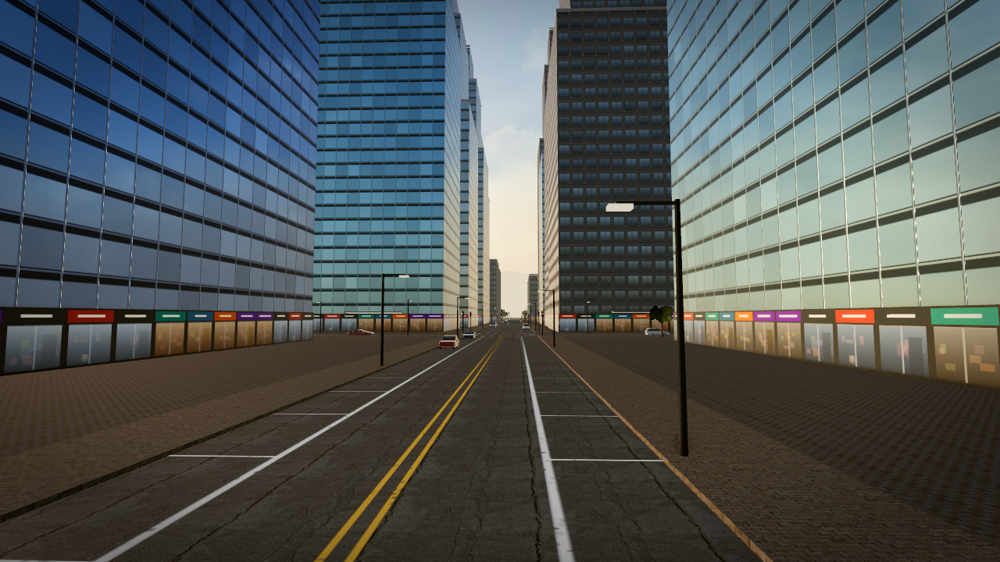
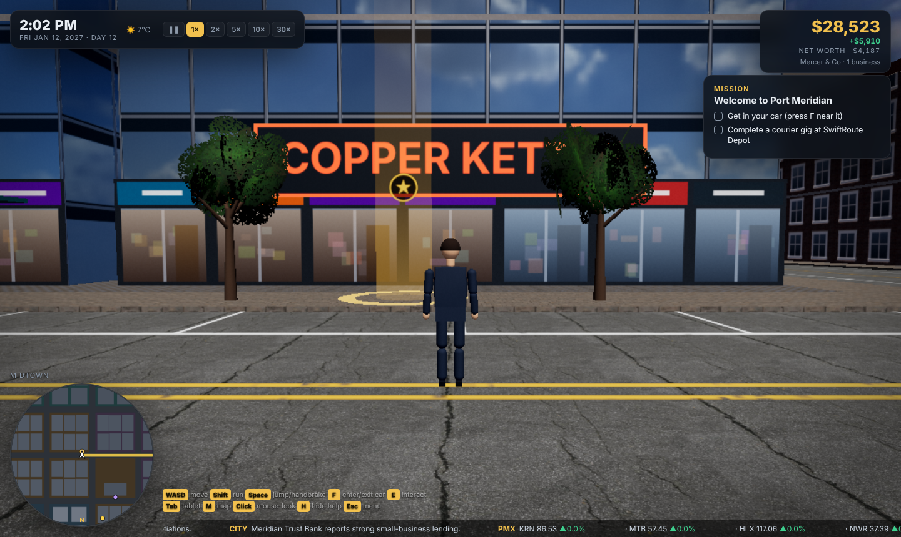
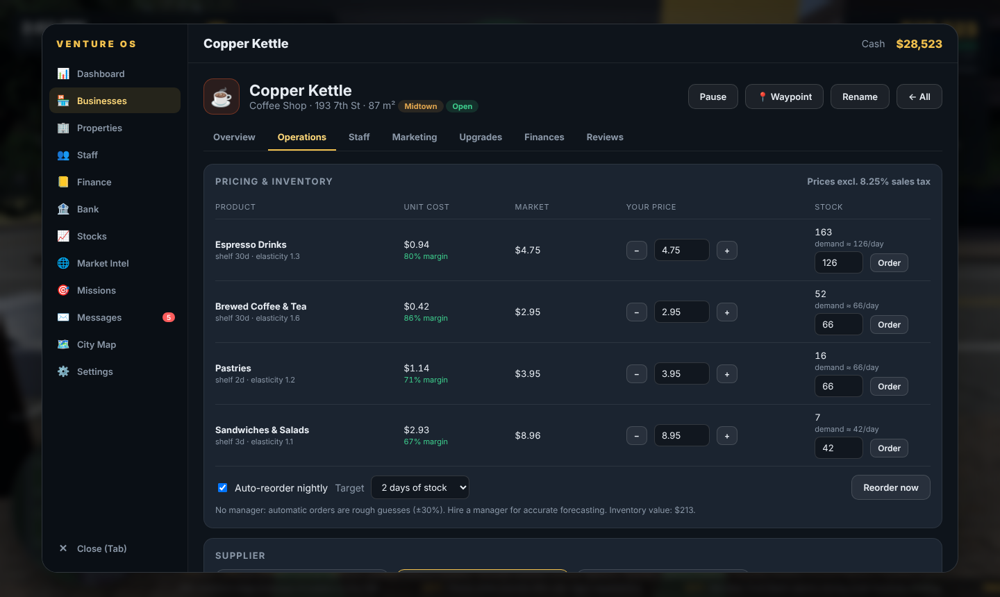

# Venture: Port Meridian

An open-world 3D business simulator that runs in the browser. You arrive in the coastal city of Port Meridian with $25,000, a rusty hatchback and an apartment in Northside. From there you register a company, lease a storefront, hire staff, set prices, manage inventory and cash flow, and grow it into a publicly traded empire. You can walk and drive anywhere in the city.


| Dusk in the Financial District | Your business on the street |
|---|---|
|  |  |



## Run it

```bash
npm install
npm run dev        # open the printed localhost URL
npm run build      # production build in dist/ (static, host anywhere)
```

The game needs WebGL 2. If the frame rate is low, open **Settings** in the tablet and pick Medium or Low, or add `?quality=medium` to the URL.

## Controls

| Key | Action |
|---|---|
| WASD / arrows | Walk, or drive the car |
| Mouse (click the game to capture it) | Look around. Esc releases the mouse |
| Shift | Sprint |
| Space | Jump, or handbrake while driving |
| F | Get in or out of your car |
| E | Interact: enter buildings, view listings, manage your businesses |
| Tab | Open the management tablet |
| M | City map, where you can set a GPS waypoint or take a taxi |
| 1–5, P | Game speed / pause |
| Mouse wheel | Camera distance |
| H | Hide the controls hint |

## What's in the game

### The world
- A procedural city of about 1.1 km × 1.1 km with seven districts: Financial District, Midtown, Northside, Westbrook, Central Park, Ironworks and Harborfront. Each has its own foot traffic, wealth, demographics, crime, rents and property prices.
- Glass skyscrapers, brick walk-ups, suburban houses, warehouses and factories, a container port with cranes, ships and piers, plus landmarks such as City Hall (columns and a dome), the bank, the stock exchange and the car dealership.
- AI traffic follows lanes, obeys traffic lights and turns at intersections. Pedestrians walk the sidewalks and step out of your way. Cars are parked along the curbs.
- A full day/night cycle using HDR skies with real clouds, which blend between day, sunset, overcast and night. Weather includes rain, storms with lightning, and fog. At night, windows, street lamps and storefronts light up.
- The car is drivable, with arcade physics, handbrake drifts, wheels that spin and steer, body roll and working headlights. You can buy faster or larger vehicles at Meridian Motors.

### Graphics
- Photographic PBR materials (CC0 from [Poly Haven](https://polyhaven.com)): asphalt, concrete pavers, paving, grass, brick, plaster, concrete cladding, corrugated metal, roof tiles, tar-gravel roofs, wood planks.
- Image-based lighting from HDRI skies, so glass towers, car paint and wet streets reflect the real sky.
- Building facades combine procedural window layouts with real wall textures tiled at true world scale, and the glass uses proper roughness and metalness.
- Soft shadows that follow the player, ground-truth ambient occlusion (GTAO), bloom, ACES tone mapping, MSAA, a cinematic colour grade and atmospheric fog.
- Clearcoat car paint, alpha-tested leaf-card trees and instanced crowds and traffic.
- Four quality presets, from Low to Ultra.

### The business simulation
- **12 business types**, each with its own economics:
  - Retail: coffee shop, bakery, restaurant, cocktail bar, fashion boutique, grocery, pharmacy
  - Memberships: fitness club
  - Hospitality: boutique hotel
  - B2B contracts: software studio, freight and logistics
  - Manufacturing: factory, with four product lines
- **Demand model.** Foot traffic depends on district, location, hour of day, weekday, season, weather, the economic cycle and festivals. Your market share against nearby competitors depends on quality, reputation, price and awareness.
- **Operations:**
  - Set a price for each product. Each product has its own elasticity.
  - Manage inventory with supplier lead times. Perishable stock spoils.
  - Choose a supplier tier, or buy from your own factory (vertical integration).
  - Set opening hours. Capacity depends on staff, seating and equipment.
- **Staff.** Candidates have skills, traits and wage demands. You can make wage offers (they may decline), give raises, train people and fire them. Morale, skill growth, poaching attempts and resignations all play a part. TalentBridge supplies premium candidates for a placement fee.
- **Marketing and upgrades.** Run campaigns from flyers up to TV, influencers and trade shows. Buy upgrades such as renovation, POS, signage, security, a loyalty programme, a delivery-app partnership, a patio, solar and automation.
- **Accounting:**
  - A full income statement (COGS, wages, payroll tax, rent, utilities, insurance, card fees, depreciation, interest)
  - A balance sheet and a ledger
  - Sales tax, quarterly income tax that depends on your legal entity, and loss carry-forward
- **Banking.** Your credit score moves with your payment history and debt use. Products include personal loans, microloans, SBA-style loans, equipment financing, commercial mortgages and lines of credit. Missed payments lead to late fees, then default and foreclosure. If your account stays overdrawn, the bank eventually forces bankruptcy.
- **Real estate.** Lease or buy retail units, office suites, warehouses, whole buildings and houses. Owned property can be rented out to tenants. Values track the economy, and you pay property tax.
- **Legal entities.** A sole proprietorship, LLC or C-Corp each changes your taxes, your liability and whether you can IPO.
- **Permits and licenses** are issued at City Hall: food service, health, liquor, pharmacy, fitness, lodging, carrier, industrial and sidewalk-café permits. Each takes real processing time.
- **Stock market.** Twelve listed companies whose prices respond to sector cycles and news. You can trade, collect dividends, take your own company public, and attempt a hostile takeover.
- **Macroeconomy.** The economy moves through expansion, peak, recession and recovery. Interest rates, inflation, wage growth, commodity prices and consumer confidence all change, and a news ticker reports what's happening.
- **Competitors**, including the aggressive rival Krane Holdings. They adjust prices, open new locations and close weak ones.
- **Random events.** These include health inspections, equipment breakdowns, burglaries, viral moments, critics' reviews, lawsuits, poaching, power outages and catering orders that you can deliver yourself.

### Missions and side activities
- A 14-mission campaign, guided by your mentor Eleanor Vance. It runs from your first courier gig through registering a company, financing, opening, finding product-market fit, building a supply chain, expansion, a price war with Krane, real estate, a million-dollar net worth, a city tender and an IPO, ending with a hostile takeover of Krane Holdings.
- SwiftRoute courier gigs come with timers, speed bonuses and fragile cargo that is damaged when you crash.
- City Hall tenders: bid against other firms, then deliver.
- A GPS route on the minimap, plus taxis for fast travel.
- The game autosaves daily and when you sleep. There are three manual save slots.

## Project layout

```
src/
  core/      utilities, input, shared context
  engine/    renderer & post-processing, HDRI sky, asset loading, facade materials, textures
  world/     city layout, mesh builder, collision, traffic, pedestrians, foliage, markers, cars
  player/    character, vehicle physics, camera
  game/      simulation: businesses, economy, finance, properties, staff, stocks, competitors,
             events, missions, gigs, government, save/load
  ui/        HUD, minimap, tablet + apps, dialogs, audio, charts
public/assets/  CC0 textures (Poly Haven) and HDR skies
tools/simtest.mjs  headless economy test, e.g. node tools/simtest.mjs cafe downtown 60
```

## Credits

Textures and HDR skies are from Poly Haven (CC0). Everything else, including geometry, characters, vehicles, UI, sound and simulation, is procedural code in this repository.
